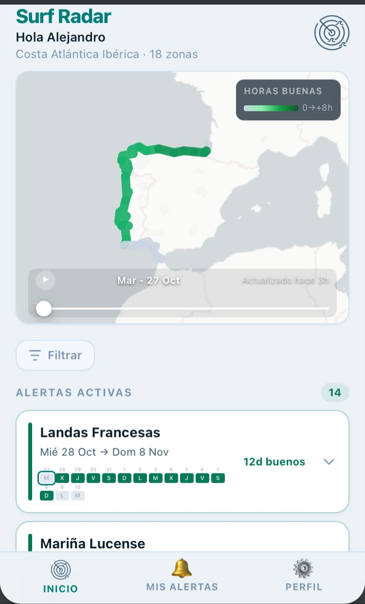
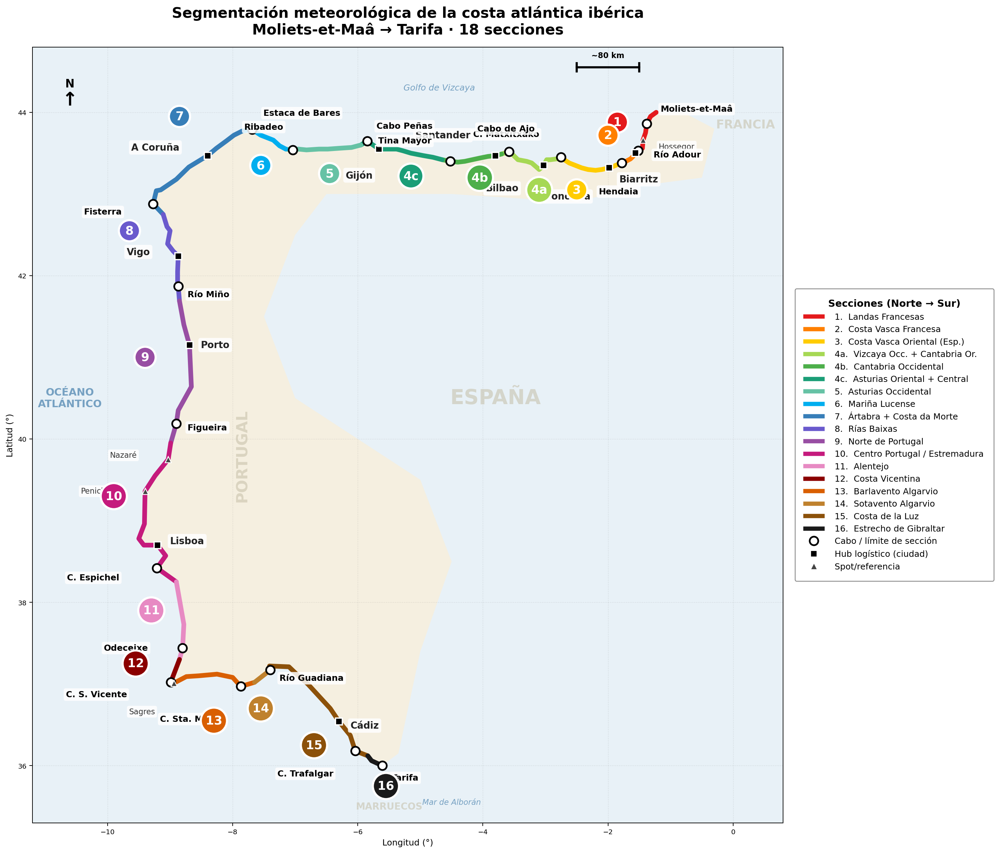
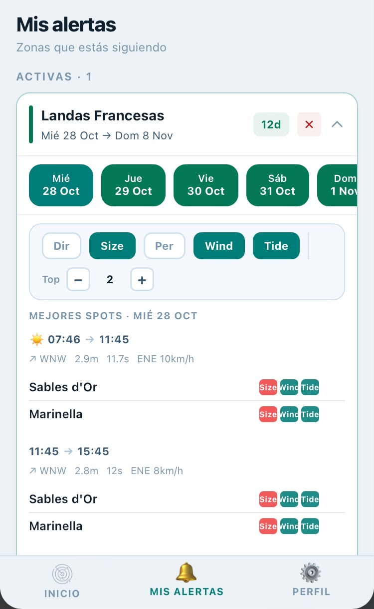
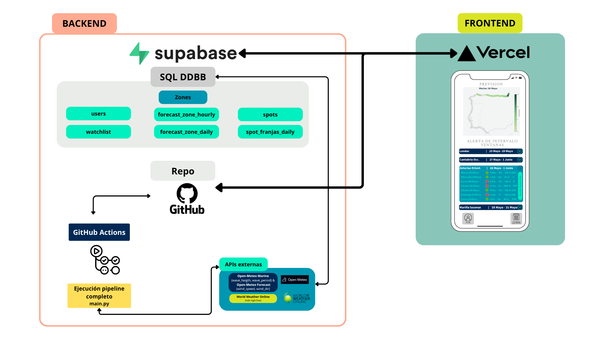
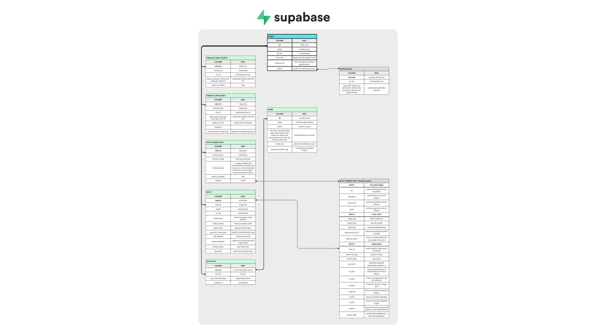
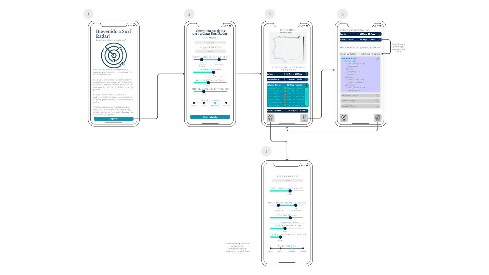
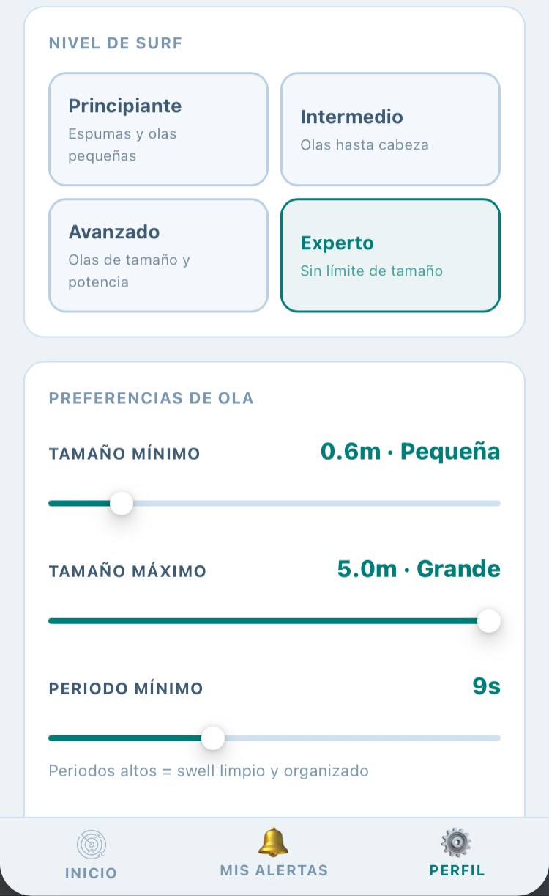
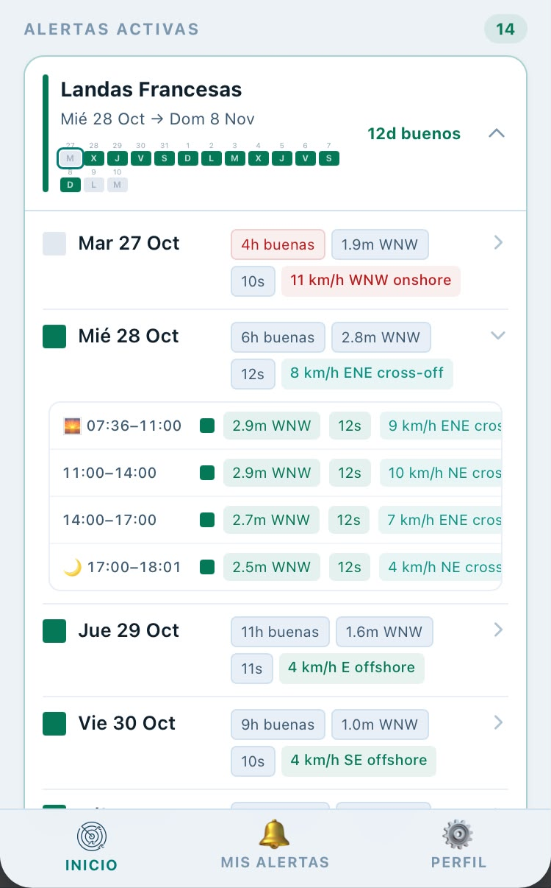

# Surf Radar

  

**A forecast engine that answers one question: *where should I surf, and when?***

Surf Radar ingests marine and weather forecasts for 18 meteorologically homogeneous
sections of the Atlantic Iberian coast — from the French Landes down to Tarifa —
evaluates them against the physical geometry of each beach, and surfaces only the
windows that are actually surfable.

Not another forecast dashboard. A **decision tool**.

`Python 3.11` · `React + TypeScript` · `Supabase / PostgreSQL` · `GitHub Actions` · `Vercel`

---

## Table of contents

1. [Introduction](#1-introduction) — demo and the problem
2. [Business Logic](#2-business-logic) — coast segmentation and how a session is scored
3. [Architecture & Data Model](#3-architecture--data-model) — how the pieces connect
4. [UX Design & Frontend](#4-ux-design--frontend) — the user journey
5. [Conclusions](#5-conclusions) — what this project became

---

## 1. Introduction

### Demo

*A walkthrough on a phone:*

- Coast map coloured by surfable hours, with a 15-day timeline
- Alert cards per zone, expandable down to hourly detail
- Spot recommender that ranks beaches by time slot
- Personal thresholds that reshape every result

### The problem

I live in Madrid, 400 km from the nearest wave. Planning a surf trip means answering a
question no forecast site actually answers: **given a free week, where should I go?**

Deciding whether a beach will work requires cross-referencing four variables that rarely
align:

| Variable | Why it matters |
|---|---|
| **Swell direction** | A coast only receives open ocean from certain bearings. Wrong angle, no waves — regardless of size. |
| **Wind** | Onshore wind destroys a swell. Offshore wind grooms it and holds the wave up. |
| **Tide** | Many breaks only work on a specific tide state. |
| **Daylight** | Perfect conditions at 3 a.m. are worth nothing. |

Forecast sites show raw numbers for one spot at a time. Covering the whole Atlantic coast
means opening dozens of tabs and doing the reasoning yourself, every single time.

Surf Radar does that reasoning across 18 zones and 342 spots, four times a day.

  

---

## 2. Business Logic

### 2.1 Segmenting the coast

Before writing any code, the hardest problem was defining **what a "zone" even is**.
Administrative borders are useless here: what matters is that a stretch of coast shares
the same swell window and the same wind regime, so that a single forecast describes it
honestly.

The result was a study of the 1,900 km between Moliets-et-Maâ and Tarifa, split into
**18 meteorologically homogeneous sections**, each bounded by a cape or river mouth where
the wave or wind regime genuinely changes.

📄 **[Full coastal segmentation study (PDF)](docs/secciones-costa-atlantica.pdf)** — section
by section, with swell windows, seasonal wind regimes, local phenomena and boundary
coordinates.

  

#### The 18 coastal sections

| # | Section | From → To | Length | Coast orientation | Ideal offshore | Peak season |
|---|---|---|---|---|---|---|
| 1 | Landas Francesas | Moliets-et-Maâ → Adour (Anglet) | ~120 km | W-WNW, straight open beach | E-ESE | Sep–Nov |
| 2 | Costa Vasca Francesa | Adour → Bidasoa (Hendaia) | ~35 km | Mixed W/NW, rocky bays | E, SE, S | Sep–Nov |
| 3 | Costa Vasca Oriental (ES) | Hondarribia → C. Matxitxako | ~90 km | N-NNE, some NW-facing | S | Oct–Mar |
| 4a | Vizcaya Occ. + Cantabria Or. | C. Matxitxako → C. de Ajo | — | Mixed, NW turning N | S | Oct–Apr |
| 4b | Cantabria Occidental | C. de Ajo → Tina Mayor | ~90 km | N-NW, open and exposed | S | Oct–Apr |
| 4c | Asturias Oriental + Central | Tina Mayor → C. Peñas | — | W, with local variation | S-SSW | Oct–Mar |
| 5 | Asturias Occidental | C. Peñas → Ribadeo | ~150 km | N, locally NNE | S, SE | Oct–Mar |
| 6 | Mariña Lucense | Ribadeo → Estaca de Bares | ~110 km | N | S, SE | Sep–Apr |
| 7 | Ártabra + Costa da Morte | Estaca de Bares → C. Fisterra | ~200 km | NW-W, N→W along the arc | E, SE | Sep–Nov, Feb–Apr |
| 8 | Rías Baixas | C. Fisterra → Miño (A Guarda) | ~150 km | W-SW (ría mouths) | E, NE | Oct–Mar + summer |
| 9 | Norte de Portugal | Miño → C. Mondego (Figueira) | ~200 km | W, straight N-S coastline | E | Oct–Apr |
| 10 | Centro Portugal / Estremadura | Figueira da Foz → C. Espichel | ~220 km | Highly varied: W, NW, N | E | Sep–May |
| 11 | Alentejo | C. Espichel → Odeceixe | ~150 km | W-SW, undeveloped | E-NE | Oct–May + summer |
| 12 | Costa Vicentina | Odeceixe → C. São Vicente (Sagres) | ~50 km | W-SW until Sagres | E-NE | Oct–May |
| 13 | Barlavento Algarvio | C. São Vicente → C. Santa Maria (Faro) | ~100 km | S-facing | N-NE | Nov–Mar |
| 14 | Sotavento Algarvio | C. Santa Maria → Guadiana (Ayamonte) | ~60 km | S-facing, barrier islands | N | Rare events |
| 15 | Costa de la Luz | Guadiana → C. Trafalgar | ~180 km | Mostly W-SW | E (Levante) | Nov–Mar |
| 16 | Estrecho de Gibraltar | C. Trafalgar → Punta de Tarifa | ~30 km | W-SW rotating to S-SE | Spot-dependent | Nov–Mar |

This table is the reason the system works. Every threshold in the database traces back to it.

### 2.2 Surf Radar: What makes a wave surfable

Each zone holds several GPS reference points (57 in total). Every hour of every point is
tested against **four eliminatory filters** — all must pass:

1. **Wave height** inside the beach's workable range
2. **Period** at or above the minimum — short period means weak, disorganised waves
3. **Swell direction** inside the zone's valid arc
4. **Wind** acceptable under the three-level rule below

Additionally the system is based on the following criteria and implementarions (click to expand):
- **Swell arcs:**A coast does not receive "a direction", it receives a **range**.
- **Daylight time:** Nigth vision for surfin hasn't been develop *YET*, so every calculations are based during thee daytime where humans use to surf
- **Sub-zones:** every zone has some sub-areas to be evaluated, it takes the Best-of-N to make the calculations
### Under the hood — technical summary

Additionally the system is based on the following criteria and implementarions (click to expand)

- **Two forecast models stitched.** ECMWF WAM 0.25° reaches ~15 days but has gaps;
  Open-Meteo's multi-model is denser but stops around day 10. WAM is primary, gaps filled
  from the secondary — 15 clean days instead of choosing between reach and density.
- **Swell arcs:**A coast does not receive "a direction", it receives a **range**.
- **Sub-zones:** every zone has some sub-areas to be evaluated, it takes the Best-of-N to make the calculations
- **Batch fetching.** All GPS points are requested in a handful of HTTP calls rather than
  one per point.
- **Circular statistics.** Directions are averaged with circular means; an arithmetic mean
  of 350° and 10° gives 180°, the exact opposite of reality.
- **Solar geometry for dayligth time.** Nigth vision for surfin hasn't been develop *YET*, so every calculations are based during thee daytime where humans use to surf. Sunrise/sunset computed per coordinate with `astral`, plus

### 2.3 Spot recommender: from zone to beach

The alerts tell you *which stretch of coast is working*. The recommender answers the
question that actually gets you in the water: **which beach, and at what time?**

Two beaches twenty minutes apart can behave nothing alike on the same morning — different
orientation, different size threshold, different tide window.

#### The groundwork

No API provides this. Every beach was catalogued by hand — **342 spots**, each described
by the conditions under which it actually works, between others features, attributes such as 

| Attribute | What it captures |
|---|---|
| `swell_optimal` / `swell_acceptable` | Bearings the beach receives, and which are merely workable |
| `offshore_dir` | Wind direction that grooms this specific beach |
| `wave_min` / `wave_max` | Below it doesn't break; above it closes out |
| `period_min` | Energy the swell needs to carry |
| `tide_optimal` | Tide states the break works on |
| `exposure_factor` | How much open-ocean swell actually reaches it |
| `bottom_type` | Sand, rock, reef or mixed |

Around 3,500 data points, built from hands-on experience and knowledge shared across the
surfing community. It is the layer that turns a regional weather forecast into advice
about a specific beach — and the most time-consuming part of the project.

#### How a recommendation is built

Daylight is split into blocks of a few hours. In each block, every spot in the zone is
scored against five conditions — **swell direction, size, period, wind and tide** — with
wave height scaled by the spot's exposure factor.

The output is a ranked list per block: *dawn to 11:45, these two beaches; 11:45 to 15:45,
these other ones*, because the wind backs off or the tide fills in and the right choice
changes with it.

  

---

## 3. Architecture & Data Model

### 3.1 Architecture: How the pieces connect

Four independent components, each doing one job:

**① External APIs.** Open-Meteo provides marine data (wave height, period, direction) and
weather data (wind speed and direction) from two separate endpoints. World Weather Online
provides tide events.

**② GitHub Actions as the scheduler.** The pipeline is a cron job, not a server. It runs
four times a day, with retries, a timeout and a concurrency guard so two runs never
overwrite the same slot. No infrastructure to maintain and no idle cost.

**③ Supabase as the single source of truth.** Managed PostgreSQL holding both the
configuration the pipeline reads and the results it writes, plus authentication and an
auto-generated REST API.

**④ Vercel for the frontend.** A React SPA deployed on every push to `main`, reading
directly from Supabase.

The key property is that **the pipeline and the frontend never talk to each other**. They
communicate only through the database, which means either side can be rewritten without
touching the other.

### 3.2 The data model

Seven tables. `zones` is the hub — everything physical hangs off `zone_id`. Columns are
documented in the diagram above; what each table is *for*:

| Table | Purpose |
|---|---|
| **zones** | Catalogue of the 18 coastal sections. Its `points` JSONB field holds the GPS reference points and their physical thresholds — the real configuration the pipeline reads. |
| **spots** | The 342 individual beaches, each with its own swell window, tide preference, exposure factor and minimum period. |
| **forecast_zone_daily** | One row per zone and day, 15-day horizon. Daily averages plus hours of valid swell. Feeds the map and the alert cards. |
| **forecast_zone_hourly** | Hour-by-hour detail, daylight hours only. Feeds the expanded day view. |
| **spot_franjas_daily** | The spot recommender, precomputed. One row per zone and day, with the whole day's time slots and spot scores serialised into a single JSONB document. |
| **users** | Surfer profile: level, wave range, minimum period, wind tolerance, trip length and home location. |
| **watchlist** | Zones a user is following, with a date range. |

Three design decisions worth calling out:

**The database is user-agnostic.** The pipeline writes physics — wave height, period,
direction, hours of valid swell. It never writes "this is a good day". User thresholds
live in `users` and are applied in the browser. A beginner and an expert read *the same
rows* and see different alerts. Had the evaluation been baked into the pipeline, every
threshold change would mean recomputing the entire database.

**Composite primary keys on every forecast table.** `(zone_id, date)` lets the pipeline run
four times a day with `upsert`, overwriting the previous forecast instead of accumulating
rows.

**Denormalised JSONB for the recommender.** The time-slot view needs N spots × 5 conditions
× every daylight hour. As relational rows it would mean several joins on every day or zone
change; as one JSONB document it is a single indexed read that paints the whole screen.

---

## 4. UX Design & Frontend

The interface was designed before the first line of frontend code, as a wireframe flow
covering the full journey from sign-up to trip planning.

### The user journey

**① Onboarding.** A short welcome explaining the premise: instead of checking a dozen
beaches yourself, set your preferences once and let the system filter.

**② Profile setup.** The user defines what *they* consider a good day: name, home city,
wave size range, minimum period, trip length, and minimum good days within that trip.

The friction here was real — a beginner has no idea what "minimum period: 9 s" means. The
solution was **four presets** (Beginner → Expert) that configure every threshold at once,
with plain-language labels. Every slider stays adjustable underneath, so the presets are a
starting point rather than a cage.

  

**③ Forecast overview.** The home screen opens on a map of the coast coloured by surfable
hours, with a timeline to scrub through the 15-day horizon. Below it, the active alerts:
one card per zone showing the date range and how many good days it contains.

**④ Progressive disclosure.** This was the central interface decision. Surf forecasting
produces an overwhelming amount of data, so the screen reveals it in three levels:

| Level | What you see |
|---|---|
| **Zone** | Date range and a strip of coloured day chips — green means surfable |
| **Day** | Wave height, period, wind and good hours, with onshore wind flagged in red |
| **Time slot** | Hour blocks with conditions for each, so you can tell a clean dawn from a blown-out afternoon |

Nothing is hidden, but nothing is shown before it is asked for.

  

**⑤ Saved alerts and spot planning.** Zones can be saved with a date range. For a saved
window, the app breaks each day into time slots and ranks the best spots in that zone for
each one, with per-condition badges showing exactly why a spot works or does not.

### Design principles

- **Mobile first.** The real use case is checking the forecast on a phone, often outdoors.
- **Colour as the primary signal.** Green works, red does not. The numbers are there for
  anyone who wants them, but the decision should be readable at a glance.
- **Plain language over jargon.** "0.6 m · Small" instead of a bare number; "high periods =
  clean, organised swell" as an inline hint.
- **No empty states without explanation.** When no spot works, the interface shows which
  condition failed rather than an empty list.

---

## 5. Conclusions

This started as a personal tool. I live in Madrid, and every time I had a week off I faced
the same problem: deciding which stretch of the Atlantic coast to drive to. I wanted
something that would tell me *where*, not just *what the waves are doing in one spot*.

It ended up as something considerably larger — an end-to-end exercise in taking a product
from idea to production:

- **Domain research.** Segmenting 1,900 km of coastline into meteorologically coherent
  sections, and translating surf knowledge — swell windows, offshore directions, tide
  behaviour — into thresholds a machine can evaluate.
- **Backend design.** A data pipeline with a clean separation between pure domain logic,
  infrastructure adapters and orchestration, with the business rules unit-tested in
  isolation.
- **Data modelling.** Designing a schema that serves two consumers with opposite needs —
  a batch writer and an interactive reader — and deciding deliberately where to normalise
  and where not to.
- **Frontend and UX.** Wireframing the full journey, solving the onboarding problem for
  users who do not speak the jargon, and designing progressive disclosure for a genuinely
  dense dataset.
- **Productionisation.** Scheduled execution, retries, idempotent writes, secret
  management, continuous deployment and monitoring, the unglamorous part that turns a
  script into a service.

What I was really after was the **full product story**, start to finish, as a real-world
exercise rather than a tutorial. The technical decisions I am most pleased with are the
ones that came from thinking about users rather than code: keeping the database
user-agnostic so preferences stay in the browser, and storing the five spot conditions
separately so the interface can explain a "no" instead of just returning one.

**Current status: Beta.** Around fifteen users are testing the app and sending feedback,
which is driving the next round of changes.

---

### A note on the source code

This repository documents the project; the implementation is private.

Surf Radar encodes spot-level knowledge,  thresholds, orientations and tide windows for
hundreds of beaches, gathered from surf guides, meteorological analysis and local
experience. That configuration is the substance of the work.

Happy to walk through the architecture or any part of the implementation on request.

---

Built by Alejandro Sánchez Silvestre · [LinkedIn](https://www.linkedin.com/in/alejandro-sanchez-silvestre-data-scientist/) · [Portfolio](https://github.com/alejosilvestre/Portfolio)
